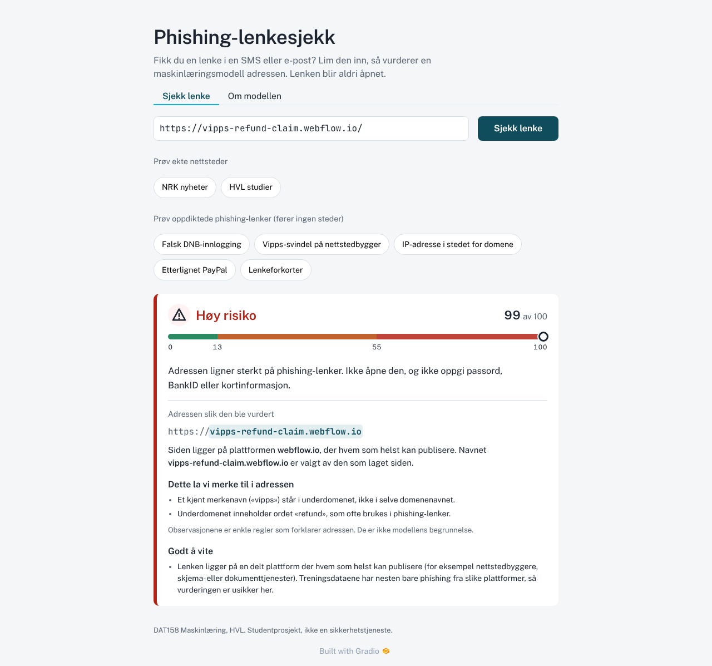

# Phishing-lenkesjekk

DAT158 Maskinlæring, HVL, høsten 2026. *ML assignment 2: Project work.*

En nettside der du limer inn en lenke og får en **risikovurdering for phishing** fra en maskinlæringsmodell. Modellen ser **bare på teksten i URL-en**: appen åpner aldri lenken og gjør ingen oppslag mot andre tjenester.

**Live-app:** https://huggingface.co/spaces/h189129/dat158-phishing-lenkesjekk

**Rapport:** [`rapport/rapport.pdf`](rapport/rapport.pdf) (LaTeX-kilde i `rapport/main.tex`)



Appen fungerer på mobil og PC, i lys og mørk modus. Resultatkortet viser risikonivå, score på en skala med de to tersklene, adressen med eieren av domenet uthevet, og hva i adressen som er verdt å legge merke til. Fanen «Om modellen» viser testresultater, forvekslingsmatrise, de viktigste kjennetegnene og begrensningene. Flere skjermbilder: [Om modellen](docs/app_om_modellen.png), [mobil](docs/app_mobil.png).

## Innhold
1. [Resultater i korte trekk](#resultater-i-korte-trekk)
2. [Kjøre appen lokalt](#kjøre-appen-lokalt)
3. [Reprodusere hele pipelinen](#reprodusere-hele-pipelinen)
4. [Deploy til Hugging Face Spaces](#deploy-til-hugging-face-spaces)
5. [Kodeomvisning: ML-livssyklusen steg for steg](#kodeomvisning-ml-livssyklusen-steg-for-steg)
6. [Viktige valg om data](#viktige-valg-om-data)
7. [Begrensninger og kjente svakheter](#begrensninger-og-kjente-svakheter)
8. [Åpenhet om metode (inkl. to testkjøringer)](#åpenhet-om-metode)
9. [Bruk av AI-verktøy](#bruk-av-ai-verktøy)
10. [Kilder og lisens](#kilder-og-lisens)

---

## Resultater i korte trekk

Gjeldende modell er **v2**. Hvordan v1 ble til v2 står i [Åpenhet om metode](#åpenhet-om-metode).

**Data:** [PhreshPhish](https://huggingface.co/datasets/phreshphish/phreshphish) (Dalton mfl., 2025), låst versjon `eca603e`. Bare URL-feltet er brukt.

| Sett | Periode | Legitime | Phishing |
|---|---|---|---|
| train_core (trening) | jul. 2024 – jun. 2025 | 181 721 | 181 550 |
| val (modellvalg og terskler) | jul. – sep. 2025 | 94 901 | 29 274 |
| test | sep. – des. 2025 | 91 199 | 72 295 |

Trening skjer på train_core pluss 235 710 utvidede legitime URL-er. Val og test evalueres uten URL-er som også finnes i treningsdataene (937 og 963 rader er fjernet).

**Modellvalg på valideringsdata.** Alle modeller er tunet med random search og 3-fold `GroupKFold` gruppert på nettsted.

| Modell | ROC-AUC | Recall ved 1 % FPR | Falske alarmer, ekte forsider | Størrelse | Tid per URL |
|---|---|---|---|---|---|
| Dummy (andel phishing) | 0,500 | 0 | – | – | – |
| Regelbasert baseline¹ | 0,603 | – | – | – | – |
| Logistisk regresjon | 0,849 | 0,455 | 2,3 % | < 0,1 MB | 0,5 ms |
| Beslutningstre | 0,867 | 0,568 | 3,8 % | 0,1 MB | 0,3 ms |
| Random forest | 0,907 | 0,591 | 5,1 % | 8,6 MB | 25 ms |
| **Gradient boosting (HGB), valgt** | 0,888 | **0,617** | 4,7 % | 0,5 MB | 3 ms |

¹ Regelen (IP-adresse, `@`, punycode, nøkkelord i underdomenet eller http) gir recall 22,6 % ved FPR 1,9 %.

Utvalgsregelen ble bestemt før kjøringen: høyest recall ved 1 % FPR blant modeller ≤ 50 MB og ≤ 100 ms. Ved likhet innenfor 0,01 vinner den med færrest falske alarmer på ekte forsider.

**Terskler** (fra val, rundet opp til hele prosent): *Høy risiko* fra score 55 (FPR 1,0 %), *Mistenkelig* fra score 13 (FPR 4,9 %).

**Test, modell v2** (kjøring 2):

| Mål | Verdi |
|---|---|
| ROC-AUC / average precision (44 % phishing) | 0,960 / 0,961 |
| *Høy risiko*: recall / FPR / presisjon | 69,7 % / 1,17 % / 97,9 % |
| *Mistenkelig* eller høyere: recall / FPR | 86,1 % / 5,4 % |
| Benchmark, 5 % phishing (5 sett): presisjon / recall | 75,9 % / 71,7 % |
| Benchmark, 1 % phishing (29 sett): presisjon / recall | 37,7 % / 71,9 % |
| FPR på legitime nettsteder modellen aldri har sett / har sett | 2,4 % / 0,5 % |
| FPR på ekte legitime forsider | 3,9 % (n = 7 369) |

Presisjonen faller når phishing er sjeldent, slik Bayes' regel forutsier. Tallene fra val forutsa 76 % og 38 % presisjon ved 5 % og 1 % phishing, og benchmarkene ga 75,9 % og 37,7 %.

**Kvalitativ sjekk på norske nettsteder** (skjult liste, frosset før v2-arbeidet):
- 10 av 10 konstruerte phishing-lenker fikk *Høy risiko*.
- 29 av 30 legitime nettsteder unngikk *Høy risiko*, men 6 havnet i *Mistenkelig*.
- Unntaket var tv2.no/nyheter (score 71), se [Begrensninger](#begrensninger-og-kjente-svakheter).

Alle tall og figurer ligger i `reports/`, og de er forklart i `notebooks/02_results.ipynb`.

---

## Kjøre appen lokalt

Krever **Python 3.12**. Den trente modellen ligger i repoet (`models/model.joblib`), så du trenger ikke trene selv for å kjøre appen.

> **Før første push til GitHub:** flytt `ci/ci.yml` til `.github/workflows/ci.yml`. Da kjøres testene automatisk på GitHub ved hver push. (Fila kunne ikke legges rett i `.github/` da repoet ble opprettet.)
> ```powershell
> mkdir .github\workflows; move ci\ci.yml .github\workflows\ci.yml; rmdir ci
> ```

**Windows (PowerShell):**
```powershell
py -3.12 -m venv .venv
.\.venv\Scripts\Activate.ps1
pip install -r requirements.txt
python app.py            # åpne http://127.0.0.1:7860
```

**macOS / Linux:**
```bash
python3.12 -m venv .venv && source .venv/bin/activate
pip install -r requirements.txt
python app.py
```

Kjør testene med `pytest -q` (110 tester).

> Appen nekter å starte hvis feature-koden (`phishcheck/canonical.py`, `domains.py`, `features.py`, `vocab.py`) er endret etter at modellen ble trent. Da må modellen trenes på nytt. Dette hindrer at appen beregner features på en annen måte enn treningen gjorde. Linjeskift (CRLF/LF) påvirker ikke kontrollen.

## Reprodusere hele pipelinen

Alle steg er skript med faste random seeds. Datasettversjonen er låst og sjekkes mot radantall og sjekksum (`data/MANIFEST.json`). Kjøretid er rundt 1 time på en bærbar PC med 2 kjerner, og minnebruken topper på rundt 4 GB.

```bash
python scripts/download.py        # PhreshPhish, låst versjon, kun URL-kolonner (~70 MB, ~1 min)
python scripts/prepare.py         # kanonisering, duplikater, train_core / val / test
python scripts/inspect_vocab.py   # (valgfritt) kandidatlistene bak vocab.py
python scripts/audit_months.py    # månedsrevisjon -> hvilke features som fjernes
python scripts/train.py           # baselines, random search, modellvalg, terskler (~20 min)
python scripts/analyze_val.py     # feilanalyse, permutation importance, læringskurve
python scripts/evaluate_test.py --force   # testevaluering (--force: bare for å reprodusere)
python scripts/monitor.py         # simulert overvåking per måned
python scripts/sanity_check.py    # kvalitativ sjekk (skjult liste + utviklingsliste)
pytest -q
```
På Linux/macOS gjør `./run_all.sh` det samme.

## Deploy til Hugging Face Spaces

1. Lag en konto på [huggingface.co](https://huggingface.co) og et **access token med write-tilgang** (Settings → Access Tokens).
   > Fra sommeren 2026 krever Hugging Face et **PRO-abonnement** for å kjøre Gradio-apper på standard CPU-maskinvare (gratiskontoer får feilen `402 Payment Required`). Appen vår kjører på en PRO-konto. Uten PRO kan appen kjøres lokalt (se over) eller på en annen tjeneste som støtter Python-webapper.
2. Sett tokenet som miljøvariabel og kjør deploy-skriptet. Det oppretter Space-et om det ikke finnes:
   ```powershell
   $env:HF_TOKEN = "hf_..."        # macOS/Linux: export HF_TOKEN=hf_...
   python scripts/deploy_space.py --space <brukernavn>/dat158-phishing-lenkesjekk
   ```
3. Skriptet laster bare opp det appen trenger (`app.py`, `phishcheck/`, modellen, `reports/test_metrics.json` og `reports/val_analysis.json`) og en egen Space-README som låser Gradio 6.30.0 og Python 3.12. Bygget tar et par minutter.
4. Lim inn lenken øverst i denne README-en.
5. `REPO_URL` i `app.py` peker til GitHub-repoet, slik at fanen «Om modellen» lenker til koden. Bytt den ut hvis repoet flyttes.

Fungerer ikke deploy, godtar oppgaven et skjermopptak av appen i bruk.

---

## Kodeomvisning: ML-livssyklusen steg for steg

Strukturen følger livssyklusen fra forelesningene (Understand the problem → Data → Modelling → Deployment).

```
phishcheck/            # Python-pakken som brukes av BÅDE trening og app
  canonical.py         # normalisering av URL-er slik nettlesere tolker dem (én kilde til sannhet)
  vocab.py             # håndkuraterte lister: delte plattformer, lenkeforkortere, nøkkelord, merkevarer
  domains.py           # Public Suffix List: registrerbart domene, plattform, forkorter, CV-grupper
  features.py          # URLFeatures: sklearn-transformer, URL-tekst -> ~40 tall; feature_code_hash()
  augment.py           # datautvidelse av legitime URL-er (stiprefikser)
  baselines.py         # regelbasert baseline
  evaluation.py        # terskel ved gitt FPR, precision/recall, presisjon ved gitt base rate
  datasets.py          # lasting av data, evalueringssett, mellomlagring av feature-matriser
  predictor.py         # appens logikk: validering av input, bånd, observasjoner, merknader
scripts/               # pipelinen, se rekkefølgen over (+ holdout_urls.py: frosset sjekkliste)
app.py                 # Gradio-grensesnittet (bokmål)
models/                # model.joblib (features + HGB i én Pipeline), metadata.json (terskler, hasher, versjoner)
reports/               # alle tall (JSON/CSV/MD) og figurer; archive_v1/ = resultater for modell v1
notebooks/             # 01_eda (dataanalyse), 02_results (modellering og resultater)
rapport/               # rapporten (PDF og LaTeX-kilde)
tests/                 # 110 enhetstester
```

| Livssyklus-steg | Hvor | Hva skjer |
|---|---|---|
| Understand the problem | denne README-en, `app.py` (fanen «Om modellen») | Mål: varsle om phishing-lenker før de åpnes. Metrikk: recall ved lav FPR, fordi falske alarmer ødelegger tilliten. |
| Define and get data | `scripts/download.py` | PhreshPhish med låst versjon. Bare kolonnene `url`, `label`, `date` og `target` leses fra parquet; HTML-en (≈190 GB) lastes aldri ned. |
| Explore data | `notebooks/01_eda.ipynb` | Fant artefakter i URL-formatet, ujevn innsamling over tid og at phishing dominerer delte plattformer. |
| Prepare data / feature engineering | `canonical.py`, `features.py`, `scripts/prepare.py`, `scripts/audit_months.py`, `augment.py` | Normalisering, fjerning av duplikater, tidsbasert splitt, rundt 40 leksikalske features, månedsrevisjon, datautvidelse. |
| Explore ML models | `scripts/train.py` | Dummy, regelbasert baseline, logistisk regresjon, beslutningstre, random forest, HGB. |
| Fine-tune | `scripts/train.py` | `RandomizedSearchCV` med egne `GroupKFold`-folder. Utvidede rader havner bare i treningsfoldene, og antall boosting-iterasjoner tunes uten tilfeldig early stopping. |
| Evaluate, analyse mistakes, feature importance | `scripts/analyze_val.py`, `reports/val_errors.md` | Kurver, forvekslingsmatrise, feil fordelt på plattform, forside, TLD og merkevare, permutation importance, læringskurve. |
| Final test | `scripts/evaluate_test.py` | Test, benchmarks ved 1 % og 5 %, per måned, ukjente nettsteder. |
| Deploy | `app.py`, `scripts/deploy_space.py` | Gradio-app på Hugging Face Spaces. Modellfila inneholder hele pipelinen, og en hash sikrer at appen bruker samme feature-kode som treningen. |
| Monitor and update | `scripts/monitor.py` | Testmånedene spilles av som ny trafikk. Regel for ny trening: FPR over 2 ganger val, eller recall mer enn 0,10 under val. Regelen slår til i september 2025 (recall 36 %). |

---

## Viktige valg om data

Dette er de viktigste funnene i prosjektet og bør diskuteres i rapporten (se `notebooks/01_eda.ipynb`).

1. **Query-strenger finnes bare hos phishing.** 0 % av de legitime URL-ene har `?…`, mot 7–12 % av phishing-URL-ene; de legitime kommer trolig fra anonymisert telemetri. Uten tiltak lærer modellen «`?` = phishing». **Tiltak:** query og fragment fjernes for alle URL-er, både i trening og i appen.
2. **Kosmetiske forskjeller ga motsatt dom.** I en tidlig prototype fikk `https://www.nrk.no` score 0,99 og `https://www.nrk.no/` 0,02. **Tiltak:** kanonisering etter samme regler som nettlesere bruker:
   - skjema, `www.`/`m.` og skråstrek på slutten;
   - små bokstaver og standardporter;
   - `\` som `/`, og at verten slutter ved `/`, `?` eller `#`;
   - prosentkodede vertsnavn, IP-adresser skrevet som tall, og IDNA.

   Tester sikrer at varianter av samme URL gir identiske features.
3. **Nesten ingen legitime forsider.** 7 % av legitime URL-er er forsider, mot 47 % av phishing. **Tiltak:** datautvidelse. Er `nettsted/a/b` legitim, er `nettsted/a` og `nettsted` det også. Det gjøres *ikke* for verter med phishing i treningsdataene eller på delte plattformer, der antagelsen ikke holder. Falske alarmer på ekte legitime forsider var 8,9 % uten utvidelse (forsøk på val), mot 4,7 % (val) og 3,9 % (test) for v2.
4. **Ujevn innsamling over tid.** Det finnes ingen legitime URL-er fra november 2024 til mai 2025. **Tiltak:** tidsbasert valideringssplitt og en forhåndsdefinert månedsrevisjon. `len_domain` og `entropy_domain` skiftet fortegn mellom måneder og ble fjernet.
5. **Delte plattformer og lenkeforkortere.** gitbook.io, weebly, webflow.io og docs.google.com har nesten bare phishing i dataene. Kryssvalideringen grupperer dem per vertsnavn (ellers registrerbart domene), og appen viser et forbehold. Lenkeforkortere, inkludert underdomener som `*.app.link`, er tatt ut av trening og evaluering; appen svarer «Kan ikke vurderes».
6. **Merkenavn matcher bare hele ord.** Det skiller mellom tre tilfeller:
   - nettstedets eget merke, som `dnb.no` eller `outlook.live.com`;
   - merke kombinert med andre ord i domenet, som `nav-utbetaling.com` eller `whatsapp16.com`;
   - merke i underdomenet eller stien, som `paypal.secure-login.com`.

   «posten» matcher ikke inni «aftenposten». Se [Åpenhet om metode](#åpenhet-om-metode) for hvorfor.

## Begrensninger og kjente svakheter

- **Bare URL-en.** Phishing på kompromitterte, ekte nettsteder (for eksempel falske PDF-er lastet opp i skjemaer på `.gov`-nettsteder i juli–september 2025) er i praksis usynlig. Det forklarer det meste av den lave recall-en i september 2025.
- **Ukjente nettsteder:** FPR er 2,4 % på legitime nettsteder modellen aldri har sett, mot 0,5 % på kjente.
- **Delte plattformer:** 25 % falske alarmer på legitime URL-er der (val, n = 924).
- **Norske nettsteder er sjeldne i dataene:**
  - Korte domenenavn med tall får for høy score: tv2.no/nyheter fikk 71 (*Høy risiko*). Diagnosen viser at det skyldes sifferandelen i en kort URL, ikke en kodefeil; tv3.no/nyheter og p4.no/nyheter oppfører seg likt.
  - Mange vanlige norske sider med kort sti havner i *Mistenkelig*. Båndet tillater 5 % falske alarmer.
- **Etterlignede bokstaver** (punycode-homografer) får ikke alltid *Høy risiko*. `xn--pypal-4ve.com` fikk 50 (*Mistenkelig*). Appen viser alltid punycode-formen, aldri de etterlignede bokstavene.
- **Merkenavn limt til andre ord** (`paypalverify.com`) gjenkjennes ikke som merkenavn. Andre features fanger ofte slike lenker likevel.
- **http** gir høy score, fordi nesten alle legitime URL-er i dataene bruker https.
- **Phishing endrer seg raskt.** Læringskurven stiger fortsatt (recall 0,56 → 0,62), så mer og nyere data vil hjelpe.

## Åpenhet om metode

**Modellversjoner og testkjøringer.** Testsettet er kjørt **to ganger**:

1. **Modell v1** (25.10.2026) ble låst og kjørt på testsettet én gang. Resultatene ligger i `reports/archive_v1/`: ROC-AUC 0,959, recall *Høy* 72,2 %, FPR 1,18 %.
2. Etterpå avdekket en **kvalitativ sjekk** på 30 norske nettsteder en **feil i feature-koden**, ikke testtallene. Merkenavn ble matchet som delstrenger («posten» inni «aftenposten»), og nettstedets eget merke ble telt som mistenkelig (vipps.no fikk 61).
3. Vi gjorde deretter en systematisk **feilsøkingsrunde** med tester først og fire runder uavhengig kodegjennomgang. Den fant og rettet blant annet:
   - URL-parsing som avvek fra nettlesere (`\`, `?` rett etter domenet, standardporter, IP-er skrevet som tall);
   - input som ble feilaktig godtatt eller avvist (`tel:`, `sip:`);
   - lenkeforkortere på underdomener;
   - feilaktige varsler (bindestreker i æøå-domener) og visning av homograf-domener;
   - lekkasje mellom datautvidelse og evaluering, og early stopping i HGB som ikke grupperte på nettsted;
   - en hash som sikrer samme feature-kode i trening og app.
4. **Én designbeslutning ble tatt på val med en regel bestemt på forhånd.** En substreng-feature for limte merkenavn ble testet. Den ga ikke minst 0,01 høyere recall (0,6302 mot 0,6301), så den ble fjernet.
5. **Modell v2** ble trent, valgt og fikk terskler på nytt med samme regler (bare train_core og val), ble låst (git-commit) og kjørt på testsettet én gang (kjøring 2, tallene over).

Testtallene fra v1 ble ikke brukt til noen beslutning, men de var kjent da v2 ble laget. v1 og v2 er ikke helt sammenlignbare: v2 fjerner i tillegg 963 testrader som var identiske med utvidede treningsrader.

**Sjekklister.** Den opprinnelige listen med norske nettsteder har påvirket utviklingen og rapporteres bare som utviklingsliste. En **ny, skjult liste** (`scripts/holdout_urls.py`, sha256 i `reports/holdout_list.sha256`) ble skrevet og frosset før v2-arbeidet og kjørt én gang etter at v2 var låst (`reports/sanity_check.md`). Begge listene er laget av oss og er ikke representative utvalg.

**Planleggingsfasen.** Før v1-designet ble låst, ble testmetrikker for tre tidlige prototypemodeller sett på, og en uavhengig gjennomgang så på fordelinger i testdataene. Designendringene som fulgte (kanonisering, datautvidelse) ble begrunnet og målt på valideringsdata.

## Bruk av AI-verktøy

Oppgaven tillater AI-verktøy så lenge det oppgis. **Claude (Anthropic)** ble brukt til:
- å analysere oppgaven og pensum og lage prosjektplanen, som gruppa godkjente;
- å skrive koden i dette repoet: pipeline, features, trening, evaluering, app, tester og notatbøker;
- å finne og dokumentere artefaktene i dataene;
- uavhengige kodegjennomganger (egne Claude-agenter som bare leste koden) i feilsøkingsrunden mellom v1 og v2.

Gruppa valgte problem, datasett og avgrensning (bare URL, ingen HTML), godkjente planen, besluttet feilsøkingsrunden (v2) og har ansvaret for innholdet. Kodeomvisningen over er laget for at hvert steg skal kunne forklares.

## Kilder og lisens

- Dalton, T., Gowda, H., Rao, G., mfl. (2025). *PhreshPhish: A Real-World, High-Quality, Large-Scale Phishing Website Dataset and Benchmark.* arXiv:2507.10854. Datasett: huggingface.co/datasets/phreshphish/phreshphish, CC BY 4.0. Bare URL-feltet er brukt, og dataene ligger ikke i repoet (lastes ned av `scripts/download.py`).
- Géron, A. (2022). *Hands-On Machine Learning with Scikit-Learn, Keras & TensorFlow* (3. utg.). O'Reilly. Kap. 2 (end-to-end-prosjekt, egendefinerte transformere, pipelines), kap. 3 (klassifisering, ROC, datautvidelse), kap. 4, 6 og 7.
- DAT158 kursmateriale, github.com/HVL-ML/DAT158 (notatbøker 1.1–2.10, figuren over ML-livssyklusen).
- WHATWG URL Standard (url.spec.whatwg.org): forenklet grunnlag for hvordan `canonical.py` tolker URL-er slik nettlesere gjør.
- Public Suffix List via `tldextract` 5.4.0 (innebygd kopi, ingen nettverkskall).
- Biblioteker: scikit-learn 1.9.1, pandas, NumPy, idna, Gradio 6.30.0, Matplotlib.

Koden er lisensiert under MIT (se `LICENSE`).
